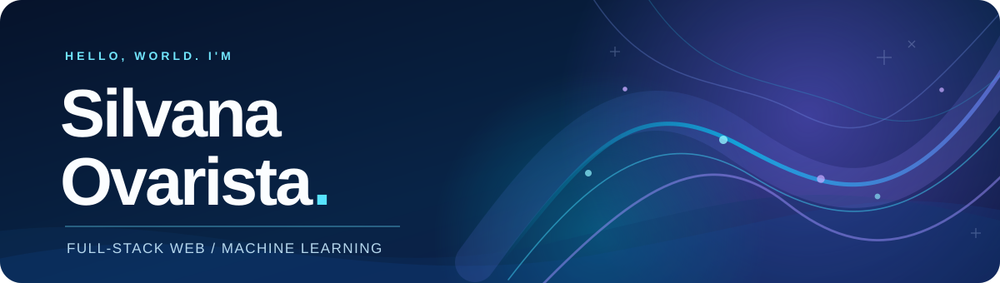

<!--
  GitHub Profile README for https://github.com/silvarsta/silvarsta
  Place README.md and the entire assets/ directory in the repository root.
  Assets are local SVGs; colorful tool badges load from Shields.io.
  This README intentionally avoids private source code and unverified project metrics.
-->

  

  
<b>Building thoughtful web experiences, from real-world workflows to human-centered interfaces.</b>

  
  
  

 

## ✦ A little about me

Hi, I'm **Silvana** 👋 — an **Informatics Engineering graduate** from **Universitas Negeri Malang**. I enjoy translating complicated ideas and workflows into web applications that people can actually use.

My everyday space is **full-stack web development**: building application features, improving interfaces, connecting backend logic to data, and making the small details work together. I'm also interested in **machine learning and NLP**, especially when research can help solve practical problems.

> **How I like to build:** understand the problem → keep the experience intuitive → make the solution reliable → iterate.

📍 Indonesia &nbsp;·&nbsp; 💼 Web Development &nbsp;·&nbsp; 🧠 Applied ML & NLP

  

## ⚓ What I'm working on

**Programmer Intern** &nbsp; · PT PAL Indonesia (Persero) &nbsp; 

Contributing to web-based applications across **assessment, HR, career, certification, and learning workflows**, including PACES, the HRIS landing page, Career PAL, LSP PAL, and LnD PAL. These are internal projects; their source code and confidential details are not shared here.

**Previously / alongside my studies**

- **Freelance Full-Stack Web Developer** — built web solutions for education and public-sector workflows, from requirements and frontend/backend implementation to database integration and maintenance.
- **Frontend Engineer Intern · SEAL (2025)** — worked on the Majadigi platform using Angular, including responsive UI development and feature improvements.
- **Web Programming Teaching Assistant · Universitas Negeri Malang (2024)** — supported students with HTML, CSS, JavaScript, PHP, Laravel, SQL, and debugging.

---

## 🎨 What I work with

*A practical toolkit, grouped by the kinds of problems I work on.*

### ✳ Frontend & UI

              

### ⚙️ Backend & databases

      

### 🧠 Machine learning & data

        

### 🛠️ Tools & collaboration

        

Also familiar with SQL, REST API integration, NLP workflows, Java, and C++. Badges indicate technologies I've worked with—not an equal level of expertise in every tool.

  

## 🚀 Selected work

*Five projects, different challenges, one goal: useful software with a clear purpose.*

### 01 / My-SAVE &nbsp;  

**A clearer journey through digital learning.** An interactive educational platform with structured learning flows, recommendation features, and a CMS for managing dynamic content. I contributed to the full website, frontend/backend features, and content management experience.

**Explore →** [mysafe-id.com](https://mysafe-id.com/)

### 02 / SD PLTB &nbsp; 

**Making disaster preparedness easier to evaluate.** A web-based assessment system for elementary schools, covering school data, assessment processes, and result dashboards.

Freelance client project · Source code not public

### 03 / SI-GELAR TIKAR PSU &nbsp; 

**From scattered documents to traceable workflows.** A system supporting the handover of housing infrastructure and public utilities, with housing records, document review, field inspections, progress monitoring, and role-based dashboards.

Freelance client project · Source code not public

### 04 / Authentic Polowijen &nbsp;  

**Connecting local culture with a digital audience.** A web-based cultural village platform with content management, local products, activity information, galleries, and storytelling features.

**Explore →** [GitHub repository](https://github.com/silvarsta/Authentic-Polowijen)

### 05 / BACARAB &nbsp;  

**A more playful way to learn Arabic.** An educational website combining gamification with structured learning modules and interactive experiences.

**Explore →** [GitHub repository](https://github.com/silvarsta/Bacarab)

---

## 🔬 Beyond the browser

### ⚖️ NLP research · Indonesian court decisions

For my thesis, I built a legal-document NLP pipeline using **22,630 Indonesian court decisions**, combining named entity recognition and **IndoLegalBERT** for classification and regression. The reported evaluations reached **86.61% F1-score** for classification and **56.52% R²** for regression.

### 🥗 Nutrimate · Personalized nutrition & exercise

A machine learning project that uses image-based food ingredient classification with TensorFlow and TensorFlow.js to support personalized meal and exercise recommendations.

---

## 🏅 A few milestones

🥇 **Gold Medal** — International Capstone Expo 2024 · Authentic Polowijen  
🥈 **Silver Medal** — Tech and Trade Expo 2024  
🏆 **1st Place** — FESMARO Scientific Paper Competition · AI-driven legal decision-support concept  
🎓 **Bangkit Academy 2024** — Machine Learning Learning Path

---

## 📊 GitHub snapshot

  
  

  
Third-party estimates may omit private activity. Language distribution reflects repository contents, not overall proficiency.

<!--
  STATS BACKUP (if the older endpoint shows 'Error Fetching Resource'):
  Replace only the domain `github-readme-stats-eight-theta.vercel.app` with `github-stats-extended.vercel.app`.
  Both services may give different figures, depending on GitHub API access and caching.
  Do not assume count_private=true unlocks private contributions on public endpoints.
-->

 

  

  <h3>Curiosity in the process. Care in the details.</h3>
  
Thanks for stopping by. If something I've built resonates with you, let's connect.

  <a href="https://v1portfolio-silva.vercel.app/">Portfolio</a> &nbsp;·&nbsp;
  <a href="https://www.linkedin.com/in/silvana-ovarista/">LinkedIn</a> &nbsp;·&nbsp;
  <a href="https://github.com/silvarsta?tab=repositories">More projects</a>

